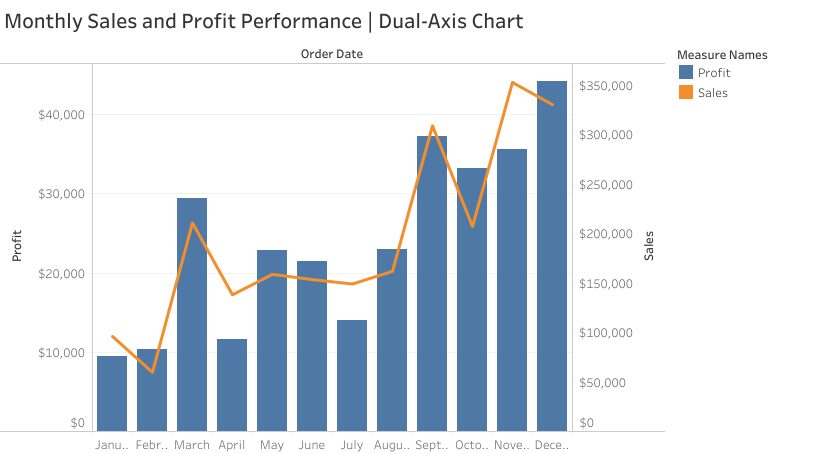
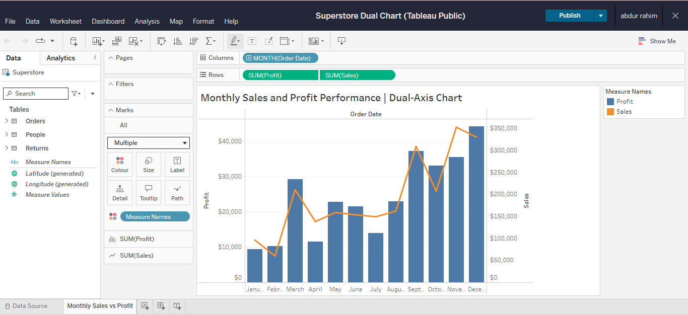

# Superstore Dual-Axis Chart

A Tableau visualization project comparing monthly Sales and Profit performance using the Sample Superstore dataset.

## Project Overview

This project demonstrates how to use a **Dual-Axis Chart** in Tableau to visualize two business measures with different scales in a single view.

- **Sales:** Displayed as an orange line chart.
- **Profit:** Displayed as blue bars.
- **Time dimension:** Monthly Order Date.

The visualization helps compare monthly sales and profit patterns and identify changes in business performance over time.

## Visualization Preview

## Tableau Workspace

## Key Tableau Techniques

- Creating a dual-axis chart.
- Combining bar and line visualizations.
- Using separate axes for measures with different scales.
- Formatting axes and currency values.
- Customizing chart titles and tooltips.

## Tools

- Tableau Public
- Sample Superstore Dataset

## Project Files

- `Dashboard/` — Tableau packaged workbook (.twbx).
- `Images/` — Visualization screenshots.
- `README.md` — Project documentation.

## Live Visualization

[View Interactive Visualization on Tableau Public]([[https://public.tableau.com/app/profile/abdur.rahim5381/viz/SuperstoreDualChart/Monthly%20Sales%20vs%20Profit](https://public.tableau.com/app/profile/abdur.rahim5381/viz/SuperstoreDualChart/Sheet1)]

## Project Type

Independent learning and portfolio project.

**Objective:** Practice Tableau dual-axis visualization techniques and communicate monthly sales and profit performance effectively.
